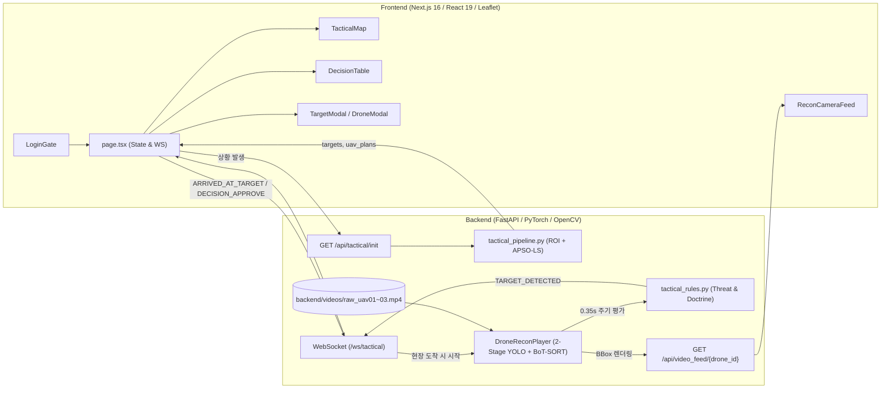

# LOOK-AT-ME C4I Technical Specification

LOOK-AT-ME C4I의 전체 구조, API, 객체 탐지·추적 파이프라인 및 위협도 계산 로직을 정리한 문서입니다.

---

## 1. 시스템 구조

---

## 2. Backend API 및 WebSocket (`backend/main.py`)

### REST API
| Method | Endpoint | 설명 |
| :--- | :--- | :--- |
| `GET` | `/api/tactical/init` | 승인 목록과 플레이어를 초기화하고 `roi_change_results.csv` 기반 10개 ROI 우선순위 및 APSO-LS 경로 반환 |
| `GET` / `POST` | `/api/tactical/reset` | `authorized_targets`, 캐시, 스트리밍을 초기화하고 WebSocket `RESET_DONE` 전송 |
| `GET` | `/api/tactical/consumption` | 이동시간과 실제 정찰시간(`ACTUAL_SERVICE_TIMES`)을 합산해 잔여 운용시간 및 15%(18분) 예비시간 계산 |
| `GET` | `/api/video_feed/{drone_id}` | `UAV-01`, `UAV-02`, `UAV-03` 추론 영상 MJPEG 스트리밍 (`multipart/x-mixed-replace`) |
| `POST` | `/api/upload_video/{drone_id}` | 비디오 파일 업로드 (`backend/videos/` 저장) |

### WebSocket (`/ws/tactical`)
- **Client → Server (`action`)**
  - `ARRIVED_AT_TARGET`: UAV 도착 시 잔여 시간 계산(`UAV_MISSION_CONSUMED` 전송) 및 `DroneReconPlayer.start()` 실행
  - `DECISION_APPROVE`: 표적 승인(`authorized_targets` 추가) 및 `DECISION_UPDATED` 전송
  - `PAUSE` / `RESET`: 스트리밍 일시 정지 또는 상태 초기화(`RESET_DONE`)
- **Server → Client (`type`)**
  - `UAV_MISSION_CONSUMED`: 잔여 운용시간 갱신 정보
  - `TARGET_DETECTED`: 0.35초 주기의 탐지 수량·기종·위협도·대응 등급
  - `DECISION_UPDATED` / `RESET_DONE`: 승인 상태 반영 및 초기화 알림

---

## 3. 2-Stage 영상 탐지·추적 파이프라인 (`DroneReconPlayer`)

| UAV | 기본 표적 | 영상 파일 | 처리 방식 |
| :--- | :--- | :--- | :--- |
| `UAV-01` | `ROI_06` | `raw_uav01_60s.mp4` | `mask_hud=True` (HUD 마스킹 + 중앙 조준선 인페인팅 + 2-Stage BoT-SORT) |
| `UAV-02` | `ROI_10` | `raw_uav02_50s.mp4` | `mask_hud=True` (HUD 마스킹 + 중앙 조준선 인페인팅 + 2-Stage BoT-SORT) |
| `UAV-03` | `ROI_08` | `raw_uav03_37s.mp4` | `mask_hud=False` (도로 영역 필터링 기반 단일 객체 추적 `_run_road_zoom_inference`) |

1. **Stage 1 (탐지 및 추적)**:
   - `best_drone_stage1_custom.pt` + `botsort_drone.yaml` (`conf=0.05`, `iou=0.45`, `imgsz=960`, `classes=[0, 1, 2]`)로 객체를 검출·추적합니다.
   - 박스 크기/비율 필터링, 수직 종대 박스 2등분 분할, 끊긴 트랙릿 재연결, 포함 관계 NMS를 적용합니다.
2. **Stage 2 (기종 분류 및 보정)**:
   - `best_yolo11.pt` (`imgsz=224`, `conf=0.10`) 배치 크롭 추론으로 `T-64`, `T-72`, `T-80`, `BTR-70`, `BTR-80`, `BMP-1`, `BMP-2`, `BMD-2`, `MT-LB`, `BM-21` 등을 분류합니다.
   - 누적 신뢰도 투표(`track_votes`), 정지 배경 필터, BBox EMA 평활화(`alpha=0.80`), 단기 미검출 보정(Coasting)을 적용합니다.
3. **렌더링 및 자원 관리**:
   - 추론한 프레임에 바로 바운딩 박스를 그려 JPEG로 인코딩하며, 현재 화면에 표시되지 않는 백그라운드 UAV(`active_viewers <= 0`)는 `0.85s` 대기를 두어 CPU 사용량을 조절합니다.

---

## 4. 경로 할당 및 위협도 계산

### 4.1 APSO-LS + Rolling Horizon (`tactical_pipeline.py`, `planner/`)
- 설정: `APSOLSConfig(n_particles=40, max_iter=80, seed=42)`, 최대 운용시간 `120.0분`, 예비시간 `18.0분`(15%).
- 예정 정찰시간: $T_i^{service} = 3.0 + 500 \cdot \text{Area}_{km^2} + 2.0 \cdot \text{Priority}$
- 실제 소모시간: $T_{consumed} = T_{travel} + T_{actual\_service}$ (`ACTUAL_SERVICE_TIMES` 기준).

### 4.2 1차 ROI 우선순위 (`PipelinePriorityCalculator`)
- 기준점(`37.8300° N, 126.7300° E`) 대비 평면 거리 $d_{ij} = \sqrt{x^2 + y^2}$ [km]를 사용합니다.

$$\text{Priority}_{ROI} = 0.4 \cdot C_{ROI} + 0.6 \cdot O_{ROI}$$

$$C_{ROI} = \text{MaxNorm}(\text{Mean\_Change} \times \text{Area}_{px}), \quad O_{ROI} = \text{MaxNorm}\left[\ln\left(1 + \sum_j w_{c_j} \cdot q_{ij} \cdot \frac{100}{100 + d_{ij}}\right)\right]$$

- 1차 가중치: `afv: 1.0`, `lmv: 0.8`, `smv: 0.6`, `mcv: 0.5`, `cv: 0.1`.

### 4.3 2차 실시간 위협도 및 대응 등급 (`tactical_rules.py`)
- 탐지 개수가 일시적으로 줄어도 이전 최고치(`prev_score`, `prev_count`)를 유지합니다.

$$s_{ij} = w_{c_j} \times q_{ij} \times \frac{100}{100 + d_{ij}}, \qquad O_{\text{Tactical}} = \min\left(1.0,\; \max\left(0.05,\; \text{round}\left(\ln\left(1 + \text{effective\_count} \cdot s_{ij}\right), 2\right)\right)\right)$$

- 2차 가중치($w_{c_j}$): `radar: 1.90`, `tel: 0.95`, `tank: 0.88`, `apc: 0.70`, `truck: 0.32`, `civilian: 0.25`.
- 대응 등급 매핑:
  - `score >= 0.85`: `🚨 긴급 타격`
  - 지휘·화력 또는 `score >= 0.745`: `🎯 지휘 타격` / `🎯 화력 타격`
  - 방공·레이더 또는 `0.73 <= score < 0.745`: `📡 방공 제압`
  - 엄체호·진지 또는 `0.715 <= score < 0.73`: `▲ 우선 타격`
  - 기동대열 또는 `score >= 0.70`: `⚔️ 기동 차단`
  - `0.60 <= score < 0.70`: `● 전술 감시` / `0.40 <= score < 0.60`: `● 경계 감시` / `< 0.40`: `● 일반 확인`

---

## 5. 프론트엔드 주요 모듈 (`frontend/src/`)

- **`LoginGate.tsx`**: `requestAnimationFrame` 기반으로 8초 주기의 레이더 회전과 표적 블립 애니메이션을 동기화합니다.
- **`ReconCameraFeed.tsx`**: 초기 감시 영상(`1st.mp4`, `2nd.mp4`, `3rd.mp4`)의 재생 시간을 전역 객체(`globalVideoTimes`)로 유지하고, 현장 도착 시 MJPEG 스트림으로 전환합니다.
- **`TacticalMap.tsx`**: Leaflet 지도 위에 UAV 마커(`zIndexOffset: 10000`), 경로, ROI 및 줌 레벨별 스케일링(`getWargameModelScale`: `0.28`~`1.30`)이 적용된 객체 마커를 렌더링합니다.
- **`DecisionTable.tsx` / `TargetModal.tsx` / `DroneModal.tsx`**: 상위 5개/전체 표적 전환 토글, 모달 드래그 이동 및 화면 배치 조정을 지원합니다.
